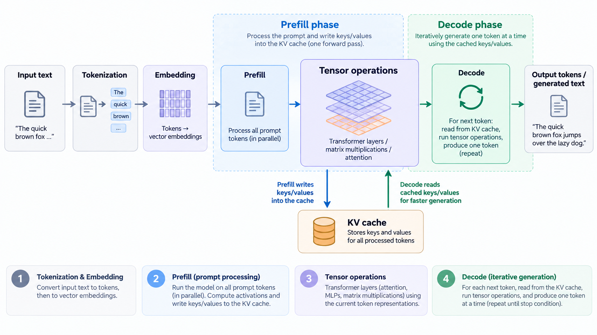
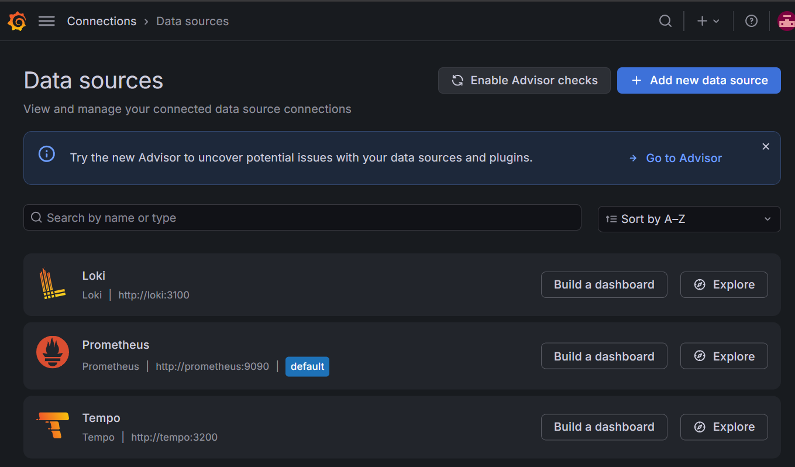

# Intro

In [part 1](https://adykaaa.github.io/blog/llm-platform-engineering-1-inference-overview/) of the series we've gone through the **inference** process on a high level. For a quick refresher:



In this particular article we will go through things such as:

- deploying a model using `vLLM` into a `minikube` cluster
- observing our model
- looking into the `KV Cache`
- stressing different parts of the inference process

and more. Before we do this though, we'll need to set ourselves up for success.

# Local environment setup

The setup script I'm about to reference assumes that you are:

- running this from a **Linux** distro (WSL2 also works)
- have **Docker** installed AND running on your machine
- have an **NVIDIA** GPU in your machine with drivers and the container toolkit installed
- have 4 `CPU` cores and 8 `GiB` of RAM available
- have sudo access

(the screenshots I'm going to be posting here are going to be from a machine using WSL2, 32 `GB` RAM, and an old `RTX 2070 8GB`)

The `01-llm-obs-setup.sh` script installs some CLI tools we'll need (`kubectl`, `helm`, `minikube`) and then it sets up a `minikube` environment that has `Grafana`, `Prometheus`, `OpenTelemetry Collector`, `Tempo` and `Loki` installed (_as minimally as possible_) and connected (alongside a cool dashboard). These tools are going to be needed to **provide an observable Kubernetes environment**, as everything we'll be doing in future articles will happen inside K8s.

The script also installs the `OpenLIT` Python SDK in a local virtual environment. We'll use it to instrument the client calling our LLM and send metrics and traces to the `OpenTelemetry Collector`. In `Grafana`, we'll view those metrics through `Prometheus` and traces through `Tempo`. We don't deploy the OpenLIT UI/backend or ClickHouse.

If your machine meets the requirements from above (_if it doesn't don't worry, just reading the article carefully will also do the job_), all you have to do is:

```bash
curl -fsSL https://raw.githubusercontent.com/adykaaa/blog/main/code/llm-platform-eng-1/01-llm-obs-setup.sh -o 01-llm-obs-setup.sh
bash 01-llm-obs-setup.sh
```

to get things going. It will take a few minutes but hopefully you'll see a message like so when the script has run:

```text
Grafana: http://localhost:3000
Username: admin
Password: <YOUR_GRAFANA_ADMIN_PASSWORD>
OTLP HTTP: http://127.0.0.1:4318
OTLP gRPC: 127.0.0.1:4317
In-cluster OTLP HTTP: http://otel.llm-obs.svc.cluster.local:4318

Forwarding runs in the background and reconnects after pod/cluster restarts.
To stop a forward, send TERM to the PID in its .pid file.
Forward PIDs/logs, values and exact versions: /home/adykaaa/.local/state/llm-obs/llm-obs
Stop the sandbox: minikube stop --profile llm-obs
Delete the sandbox AND its stored data: minikube delete --profile llm-obs
```

To double check whether everything is setup as it should be, we can head over to `http://localhost:3000` and log into `Grafana` using the username `admin` and the printed admin password. Then go into `Connections -> View Configured Data Sources` and all 3 of these should be set up:



and also make sure you have no PODs that are not in a `Running` state:

```bash
 kubectl --context llm-obs get pods --all-namespaces --field-selector=status.phase!=Running
```

For stopping the cluster you can do `minikube stop --profile llm-obs` and to start it again: `minikube start --profile llm-obs` (_wait a few mins so all PODs come up healthy_).

To **nuke** it out of existence use `minikube delete --profile llm-obs`.

# Model engine and server

## Engine

In [part 1](https://adykaaa.github.io/blog/llm-platform-engineering-1-inference-overview/) of this series we have learnt about **inference**. If we take a step back though, when we look at a model on HuggingFace, all we see is a bunch of files -- one of which is the `model.safetensors` one that we touched on in the article. If we just download all those files, how do we run the LLM?

This is where a model engine comes in. A model engine basically knows how to take all of those files, **allocate** GPU space for them, **load** them onto the GPU(s), and them **execute** the model. This is all we need to know for now. We'll be using [vLLM](https://vllm.ai/).

We'll have a completely separate article dedicated just to `vLLM`, so this is why I'm not diving deeper into it here. It does a LOT more than just running our model, but more on that later.

## Model server

It's great to have a model engine that knows how to run a model, but we need a **server** that wraps that engine so that it can accept requests and provide responses (_after all if there is no server, where will our users send the prompts to the LLM?_). `vLLM` also acts as a model server, so we can kill 2 birds with 1 stone by using it :)

#
